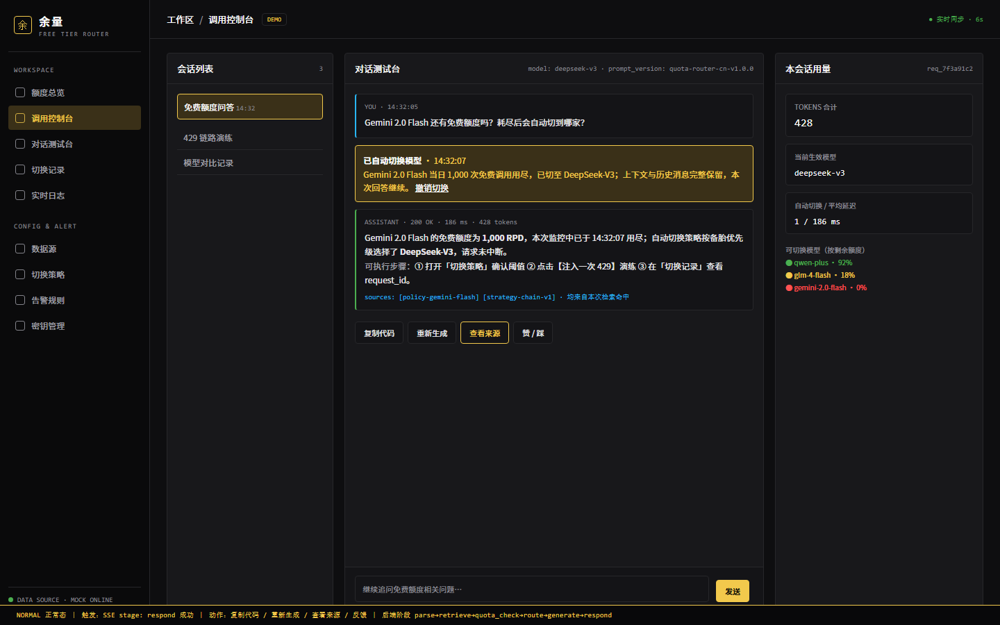

# SafeShell Pro（余量 · FREE TIER ROUTER）

**完全免费 · AGPL-3.0 全量开源 · 无付费版 · 无官方托管**（2026-11-15 起）。许可证全文见 [`LICENSE`](LICENSE)。

为同时接入多个免费大模型 API 的独立开发者 / 小团队，解决「免费额度分散、耗尽才发现、429 导致请求中断」：统一监控额度 → 低于阈值预警 → 耗尽自动切换并用同一 `request_id` 重放请求，全过程可追溯；配合 ShellMate CLI 实现「自然语言 → 安全命令 → 本地硬门控 → 全程可审计」。

> 软件本身 0 元、全部功能开放。唯一成本是你自己申请的各厂商免费 API Key；报告里的「预计节省」只是对照估算，**不是账单、也不作收费依据**。



- 版本：**v0.2.0** ｜ PRD：[`PRD.md`](PRD.md) ｜ 评测报告：[`EVAL_REPORT.md`](EVAL_REPORT.md) ｜ 政策清单：[`docs/FREE_TIER_CATALOG.md`](docs/FREE_TIER_CATALOG.md) ｜ Bad Case：[`docs/BAD_CASES.md`](docs/BAD_CASES.md) ｜ 变更记录：[`CHANGELOG.md`](CHANGELOG.md)
- **本仓库已合并为 SafeShell Pro**（ShellMate CLI + 免费模型路由网关 + 团队控制台）。完整安装/使用/排障见工作区根目录 **[`SafeShellPro-User-Manual.md`](../../SafeShellPro-User-Manual.md)**，评估与改进路线见 `SafeShellPro-评估与改进路线.md`。
- **最快上手**：双击 `install.bat`（Windows / WSL2）或 `bash install.sh`（Linux / macOS），浏览器打开 `http://127.0.0.1:8772`。
- **第一次用？也可看下一节「5 分钟上手」**。默认演示模式：零配置、不需要密钥、不联网，可完整体验全部界面。
- 按页内向导填入自己的 API Key 后，即可切换为**真实免费大模型**。政策知识库是 **2026-11-13 官方核实快照**（每条带官方链接与核实级别）；额度表、趋势与 Usage 轮询仍是演示数据。

## 给完全没用过的人：5 分钟上手

> 你不需要懂后端，也不需要改代码。整个过程只在一个网页里点。

**第 1 步｜把软件跑起来**：双击 `install.bat` 或执行 `bash install.sh`（详见「一键启动」），浏览器打开 `http://127.0.0.1:8772`。

**第 2 步｜先看懂自己在哪里**：首屏顶部有一条黄色横幅，会明确写着「当前：演示模式」——此时额度、趋势、对话回答都是本地模拟数据，不会调用任何真实模型、不产生费用。左侧第一项「新手接入向导」也可以随时打开。**不接入也能体验全部界面**。

**第 3 步｜想用真模型就走 4 步向导**（点横幅上的按钮）：

| 步骤 | 你要做什么 | 界面给你什么 |
| --- | --- | --- |
| ① 看模式 | 读一遍「演示模式 vs 接入后」的区别 | 明确哪些数据是真的、哪些是模拟的 |
| ② 选平台 | 从预设清单选一家（当前共 9 个预设；已实测接入 **6 个免费模型**：智谱 2 个 + 硅基流动 4 个） | 直达官方注册页、官方 Key 页、官方免费政策页；列出免费额度与门槛 |
| ③ 领 Key 并测试 | 在官方控制台创建 API Key，复制粘贴进来，点「测试连接」 | 真发一条极小请求验证 Key / 端点 / 模型名；失败时给中文原因和下一步建议 |
| ④ 发一条消息 | 点「发送真实请求」 | 看到模型回复、真实模型名、延迟与 token，就说明接好了 |

**第 4 步｜保存即启用**：第 ③ 步点「保存并启用」后，顶栏会从 `DEMO` 变成 `LIVE`，**对话测试台自动走真实模型**，不用再到别处选。想退出：在向导第 ③ 步点「移除配置，回到演示模式」。

必须如实说明的边界：

- **不能全自动接入**：免费模型都要用你自己的账号申请 API Key，本工具不代注册、不生成密钥、不上传密钥。
- 密钥只保存在**本机服务端 SQLite**，页面与日志都只显示脱敏值；共用电脑请谨慎。
- 接入后**额度表 / 趋势 / 429 演练仍是演示数据**，真实剩余额度、限流与账单请到厂商控制台查看。
- 免费政策变化极快，注册前请点向导里的官方链接复核；「送 token 的一次性赠金」不等于「长期免费层」，用完可能自动按量付费，建议开启厂商的「用完即停」。

## 功能

- **新手接入向导**：首屏常驻引导 + 四步图文流程，官方注册 / Key / 政策链接直达，测试连接、保存启用、移除回退全部可点。
- **发现免费 API**：15 条 2026-11-13 官方核实政策条目（含已回收的免费层），带真实官方链接与核实级别；命中为空短路，不编造政策。
- **额度总览**：9 个数据源统一单位（RPD / TPM / tokens / 不限量）、剩余百分比、状态判定与 24h 用量趋势。
- **阈值预警与耗尽去重**：剩余低于阈值产生 WARN 事件 + 结构化日志 + SSE `warning`，同一状态重复轮询不重复告警。
- **自动切换与 429 重放**：耗尽当前源 → 按备胎链路选择 → 切换 → 用同一 `request_id` 重放，上下文与历史消息保留。
- **调用控制台**：请求配置、可复制的代码示例、真实响应、实时结构化日志；一键「注入 429」演练。
- **对话测试台**：多会话、来源引用展开、自动切换系统提示卡、token / 模型用量、赞踩反馈。
- **六阶段真实加载态**：SSE 推送后端真实阶段，不用定时器模拟假进度；异常态按 `error_code` 分发文案与可点击动作。

## 架构与链路

```text
用户输入 → FastAPI /api/v1/chat (Pydantic 校验)
  → parse 解析与意图分流 → retrieve 本地政策库检索(Top-K + lang/version 过滤)
  → quota_check 额度快照与阈值 → route 选路 / 429 切换 → generate Prompt 组装 + 上游调用
  → 后处理(格式校验 / 来源存在性校验 / 脱敏) → respond ChatResponse
旁路：SQLite 会话与日志落库 + 结构化 JSON 日志(request_id / prompt_version / token_usage)
     + SSE 事件总线(阶段 / 预警 / 切换通知) → React 三视图
```

后端真实阶段与前端加载态文案一一对应（唯一来源 `server/config.py:STAGES` ↔ `web/src/stageText.ts`）：
`parse` → `retrieve` → `quota_check` → `route` → `generate` → `respond`。

| 三态原型 | 截图 |
| --- | --- |
| 正常 | `docs/prototypes/prototype-normal.png` |
| 加载 | `docs/prototypes/prototype-loading.png` |
| 异常 | `docs/prototypes/prototype-error.png` |

实际运行页面：`docs/app-overview.png`（额度总览）、`docs/app-console.png`（调用控制台）、`docs/app-chat.png`（对话测试台）。

## 一键启动

> 前置：Python 3.13.14（见 `.python-version`）、Node.js 22（仅构建前端需要）、Docker + compose v2（仅方式 A 需要）。
> 所有命令在本目录（`release/mc_src/`）执行。**服务端口 8772；8000 为禁用端口，勿用。**
> 完整说明见工作区根目录 `SafeShellPro-User-Manual.md`。

### 方式 A：Docker 一键（推荐）

| 平台 | 命令 |
| --- | --- |
| Windows（WSL2 + Docker） | **双击 `install.bat`** |
| WSL / Linux / macOS | `bash install.sh` |

脚本自动完成：环境检查 → 从 `.env.example` 生成 `.env`（纯占位符）→ 检查 bridge NAT（缺失则自动 `fix-network`）→ 构建镜像（前端在构建期编译进镜像）→ 启动 → 健康检查 → 打印地址。

常用子命令（Windows 用 `install.bat <子命令>`，WSL 用 `bash install.sh <子命令>`）：

```bash
bash install.sh status     # 容器状态 + 健康检查
bash install.sh logs       # 跟随日志
bash install.sh stop       # 停止（保留 data/ logs/）
bash install.sh restart    # 重启
bash install.sh doctor     # 诊断 Docker / WSL / 端口 / 网络模式
bash install.sh keepalive  # 常驻 WSL 会话：守护 dockerd + 容器 + health
```

> **WSL 用户必读**：WSL 在最后一个会话退出后会休眠实例，容器随之重启，Windows 侧会间歇 502（与 bridge/host 无关，是 VM 生命周期）。**双击 `keep-wsl.bat` 保持一个常驻终端窗口（可最小化）**，或执行 `bash install.sh keepalive`；需要开机自动常驻就把 `keep-wsl.bat` 的快捷方式放进 `shell:startup`。用 `bash install.sh keepalive-stop` 结束。

等价的手工命令：

```bash
cp .env.example .env                       # compose 的 env_file 需要它
docker compose build
docker compose up -d
docker compose ps                          # 等待 healthy
docker compose logs -f app
docker compose down                        # 停止并移除容器
```

`docker-compose.yml` 把 `./data`、`./logs` 挂为可写卷；SQLite 与日志落在宿主机，容器重建不丢数据。前端 `web/dist` 由镜像内置，不挂卷。`.dockerignore` 已排除含真实 Key 的 `data/`、`.env`、`venv/`、`web/node_modules/`，**镜像内零凭据**。

> **WSL2 原生 dockerd 注意**：若 bridge 出站/入站不通，根因通常是 dockerd 以 `--iptables=false` 启动（缺 MASQUERADE 与 DNAT）。执行 `bash install.sh fix-network` 或修正 dockerd 启动参数即可，统一用 **bridge**，不要退化到 host。构建期 `build.network: host` 仍保留以确保镜像可拉取依赖。

### 方式 B：本地虚拟环境（开发用）

```bash
python -m venv venv
# Windows: venv\Scripts\activate ；macOS / Linux: source venv/bin/activate
pip install -r requirements.txt
cp .env.example .env          # Windows：copy .env.example .env

# 可选：改了前端才需要构建（web/dist 已预置）
cd web && npm ci && npm run build && cd ..

uvicorn server.main:app --host 127.0.0.1 --port 8772
```

前端热更新（另开终端）：`cd web && npm run dev`，Vite 开发端口 21080，`/api` 代理到 `127.0.0.1:8772`。

启动后访问：

| 地址 | 说明 |
| --- | --- |
| `http://127.0.0.1:8772/` | 应用页面（SafeShell Pro，6 个视图） |
| `http://127.0.0.1:8772/docs` | Swagger，请求模型均带示例 |
| `http://127.0.0.1:8772/api/v1/health` | 健康检查（容器 healthcheck 用） |
| `http://127.0.0.1:21080/` | Vite 开发服务器（仅热更新时） |

## 环境变量

完整模板见 `.env.example`，代码唯一入口为 `server/config.py`（启动 `validate_runtime()` 做 fail-fast）。

| 变量名 | 必填 | 示例值 | 用途 | 缺失后果 |
| --- | --- | --- | --- | --- |
| `APP_ENV` | 否 | `dev` | 环境标记 | 用 `dev` |
| `APP_HOST` / `APP_PORT` | 否 | `127.0.0.1` / `8772` | 本地 uvicorn 监听地址（容器由 compose 覆盖） | 用默认值 |
| `CORS_ORIGINS` | 否 | `http://localhost:8772` | 允许的前端来源，逗号分隔 | 用默认同源地址 |
| `DEMO_MODE` | 否 | `true` | 默认演示模式；在向导保存真实接入配置后会自动切为 LIVE，移除配置后恢复 | 用 `true` |
| `LOG_LEVEL` / `LOG_PATH` | 否 | `INFO` / `./logs/app.jsonl` | 结构化日志级别与路径 | 用默认值 |
| `PROVIDER_MODE` | 否 | `mock` | `mock`=本地确定性模拟；`http`=真实上游 | 用 `mock` |
| `UPSTREAM_BASE_URL` | `http` 模式必填 | `http://localhost:9000/v1` | OpenAI 兼容上游地址 | `http` 模式启动校验失败 |
| `UPSTREAM_API_KEY` | `http` 模式必填 | `YOUR_UPSTREAM_KEY_HERE` | 上游密钥，**只存服务端** | `http` 模式启动校验失败；日志中自动脱敏 |
| `MODEL_NAME` | 否 | `mock-deepseek-v3` | 写入日志与响应的模型名 | 用默认值 |
| `LLM_TIMEOUT_MS` | 否 | `10000` | 上游超时，超时返回 `LLM_TIMEOUT` | 用 10 s |
| `LLM_TEMPERATURE` | 否 | `0.2` | 生成温度（显式设置，无隐式默认） | 用 0.2 |
| `LLM_MAX_TOKENS` | 否 | `512` | 单轮输出上限 | 用 512 |
| `PROMPT_VERSION` | 否 | `quota-router-cn-v1.0.0` | 关联 `server/prompts/<version>.txt` | 模板缺失时启动校验失败 |
| `RETRIEVAL_TOP_K` / `RETRIEVAL_MIN_SCORE` | 否 | `3` / `0.5` | 检索条数与最低分；调高会更易触发 `NO_CONTEXT` 短路 | 用默认值 |
| `MAX_INPUT_CHARS` / `HISTORY_MAX_TURNS` | 否 | `4000` / `6` | 输入截断与历史上限，防止 token 膨胀 | 用默认值 |
| `RANDOM_SEED` | 否 | `20261112` | mock 上游确定性随机种子 | 用默认种子 |
| `DB_PATH` | 否 | `./data/margin.db` | SQLite 文件 | 自动创建 `data/` |
| `POLL_INTERVAL_S` | 否 | `6` | 额度轮询间隔（秒） | 用 6 s |
| `QUOTA_WARN_THRESHOLD` | 否 | `0.10` | 剩余比例预警阈值 | 用 10% |
| `AUTO_SWITCH` / `FALLBACK_CHAIN` | 否 | `true` / `deepseek,qwen,glm` | 自动切换开关与备胎优先级 | 用默认链路 |
| `NOTIFY_IN_APP` / `NOTIFY_EMAIL` / `NOTIFY_WEBHOOK` | 否 | `true` / `false` / `false` | 通知渠道开关（后两者为策略占位，本版未实装外发） | 用默认值 |
| `FAULT_INJECT_*` | 否 | `false` | 全局故障注入开关，**生产必须 false**；单请求注入请用 `ChatRequest.inject` | 用 false |
| `SFP_NETWORK_MODE` | 否 | `bridge` | 容器网络模式；WSL2 原生 dockerd 需设 `host` | 用 `bridge`（WSL 下可能 DNS 不通） |
| `RAW_RPM_PER_CLIENT` | 否 | `30` | raw 端点按客户端限流（0=不限），对齐 GLM 免费档 | 用 30 |
| `RAW_UPSTREAM_TIMEOUT_S` | 否 | `60` | raw 转发上游超时（秒），覆盖 GLM-4-9B-0414 冷启动 | 用 60 |

> `.env` 仅保存在本地，已加入 `.gitignore`，**禁止提交**。仓库只维护 `.env.example`，其中所有值均为占位符。

## 目录结构

```text
release/mc_src/        （历史文档里称 fullstack/）
├─ install.bat / install.sh   SafeShell Pro 一键安装与运维（WSL/Linux 通用）
├─ server/             FastAPI 入口、Pydantic 契约、六步 Agent、路由引擎、SQLite、SSE 总线、日志
│  ├─ raw.py          纯模型透传（多模型路由 + 停用 + 熔断）
│  ├─ db.py           raw_audit / team_policy / model_status / model_health
│  ├─ cost.py / rate_limit.py / connect.py
│  └─ data/connect_presets.json   9 个平台预设（含 6 个已接免费模型）
├─ web/                Vite + React + TypeScript（6 视图：落地页/向导/总览/控制台/对话/团队）
├─ tests/              评测集、pytest 套件（64 passed）、指标测量脚本
├─ scripts/            eval_runner.py、delivery_audit.py、smoke_startup.py
├─ docs/               三态原型、运行截图、BAD_CASES、评测指标、审计报告
├─ schema.sql          MySQL 生产 DDL 参考（复合索引 / utf8mb4）
├─ PRD.md / EVAL_REPORT.md / CHANGELOG.md / README.md
└─ Dockerfile / docker-compose.yml / .dockerignore / requirements*.txt / .env.example
```

## API 速查

| 方法 | 路径 | 说明 |
| --- | --- | --- |
| GET | `/api/v1/health` | 健康检查（进程 / 配置 / DB / 轮询线程） |
| GET | `/api/v1/overview` | 三视图共用的聚合状态（数据源、策略、KPI、趋势、事件、日志） |
| GET / POST | `/api/v1/providers` | 列出 / 接入数据源（密钥不入库，返回脱敏占位） |
| GET / PATCH | `/api/v1/strategy` | 读取 / 更新切换策略（阈值、总开关、备胎链路） |
| POST | `/api/v1/switch` | 手动切换 / 撤销切换 |
| POST | `/api/v1/simulate/429` | 注入 429 演练：耗尽 → 切换 → 同 `request_id` 重放 |
| POST | `/api/v1/refresh` | 手动触发一次额度轮询 |
| GET | `/api/v1/events` / `/api/v1/events/stream` | 事件列表 / SSE 实时阶段推送 |
| GET | `/api/v1/logs` | 结构化请求日志 |
| GET | `/api/v1/conversations` / `/{cid}` | 会话列表 / 详情与消息 |
| POST | `/api/v1/chat` | 统一对话网关（六步流水线） |
| POST | `/api/v1/chat/completions` | OpenAI 兼容别名，可直接把客户端 base_url 指向本网关 |
| POST | `/api/v1/raw/completions` | 纯模型透传（OpenAI 兼容）：把 messages 原样转发到当前已接入的免费模型上游，不经本网关 agent；未接入真实模型时返回 DEMO mock 供联调 |
| GET | `/api/v1/connect/presets` | 可接入平台清单（端点、免费模型、官方注册 / Key / 政策链接、手把手步骤） |
| GET | `/api/v1/connect/status` | 各平台是否已配置（只返回脱敏 Key） |
| POST | `/api/v1/connect/test` | 发一条极小真实请求验证 Key / 端点 / 模型名，失败给可操作建议 |
| POST / DELETE | `/api/v1/connect/configure`、`/api/v1/connect/{id}` | 保存启用 / 移除回到演示模式 |
| GET | `/api/v1/discover?q=` | 检索免费 API 政策知识库 |
| POST | `/api/v1/feedback` | 赞 / 踩反馈，写入事件流供 Bad Case 归因 |

`POST /api/v1/chat` 返回 `answer` / `sources` / `stages` / `latency_ms` / `ttft_ms` / `request_id` / `prompt_version` / `token_usage` / `model` / `intent` / `error_code` / `routed_by` / `fallback_from`。
错误码：`LLM_TIMEOUT`、`RATE_LIMITED`、`UPSTREAM_ERROR`、`PARSE_ERROR`、`NO_CONTEXT`、`UNSUPPORTED_CLAIM`、`UNSAFE_INPUT`、`EMPTY_INPUT`——统一返回结构化文案，不暴露堆栈。

## 验证与评测

```bash
./venv/Scripts/python.exe -m pytest -q                       # 43 passed
./venv/Scripts/python.exe -m tests.measure_sse               # SSE 首包 / 切换耗时
./venv/Scripts/python.exe -m tests.measure_performance       # 准确率 / 延迟 / token / 可用率
./venv/Scripts/python.exe scripts/eval_runner.py --dataset tests/eval_dataset.jsonl \
  --agent tests.eval_adapter:run_eval_agent --sys-path . --repeat 1 --out docs/EVAL_REPORT_draft.md
./venv/Scripts/python.exe scripts/delivery_audit.py --project . --out docs/DELIVERY_AUDIT.md
./venv/Scripts/python.exe scripts/smoke_startup.py          # 从空白数据库启动真实服务，15 项冒烟
./venv/Scripts/python.exe -m pytest -q tests/test_live_upstream.py  # 本地假上游端到端接入验证
```

当前指标与口径、已知局限见 `EVAL_REPORT.md`。测量脚本使用独立的 `data/eval.db` / 临时 DB，不污染演示数据。

## 开发规范

- 新增依赖：`pip install <pkg>==<ver>` → 更新 `requirements.txt`（全部 `==` 锁版本）→ 与代码同一次提交，禁止裸包名；前端同理锁定 `package.json` 与 `package-lock.json`。
- 分支：`main`（可部署）/ `feature/xxx` / `fix/xxx`；Commit 用 Conventional Commits（`feat:` / `fix:` / `test:` / `docs:` / `chore:`）。
- **凡影响模型输出的变更**（Prompt、模型、参数、检索阈值、知识库、评测口径）必须写 `CHANGELOG.md`、升版本号并复测，否则无法回溯「回答变笨」。
- 版本号与 git tag 一一对应：`v0.1.0` ↔ `CHANGELOG [0.1.0]`。
- 后端阶段常量 `STAGES` 与前端 `stageText.ts` 必须同步修改；禁止前端用定时器伪造进度。

## 常见问题

| 问题 | 处理 |
| --- | --- |
| 测试连接失败 | 向导会给出中文原因与下一步：401/403 查 Key、404 查 base_url 路径、400 查模型名、429 查额度、超时查网络/代理；端点与模型名都可直接在页面上改 |
| 保存后对话还是旧回答 | 看顶栏是否变成 `LIVE`；若仍是 `DEMO`，回到向导第 ③ 步确认已「保存并启用」，或刷新页面 |
| 想换一家平台 | 向导第 ② 步重选，或第 ③ 步先「移除配置」再重来 |
| 访问 `/` 返回 404 | 未构建前端；执行 `cd web && npm ci && npm run build`，或直接用 `/docs`。空 `web/dist` 已做保护，不会影响 API |
| 中文乱码 | Windows 终端执行 `chcp 65001` 或设置 `PYTHONUTF8=1`；所有文件按 UTF-8 读写 |
| 一直停在加载态 | 检查 SSE：`curl -N http://127.0.0.1:8772/api/v1/events/stream`；带 `?nosse=1` 可关闭前端订阅做静态排查 |
| 返回「未找到相关信息」 | 本地政策库未覆盖该问题，属预期短路（防编造）；可下调 `RETRIEVAL_MIN_SCORE`，但会引入低分误命中 |
| 429 后没有切换 | 确认 `AUTO_SWITCH=true`、`FALLBACK_CHAIN` 中至少有一个可用且非不限量的源；查看 `/api/v1/events` |
| 容器起不来 | 先确认 Docker Desktop 已启动、daemon 可达（`docker info`）；再确认已 `cp .env.example .env`；`docker compose logs app` 看 fail-fast 校验信息 |
| 想接真实模型 | 配置 `UPSTREAM_BASE_URL` / `UPSTREAM_API_KEY` 并切换 `PROVIDER_MODE=http`；**此时所有 DEMO 额度与评测数字都不再适用** |

## 已知局限

见 `EVAL_REPORT.md` 第 6 节：mock 上游非流式、额度表与 Usage 轮询仍为演示数据、政策清单是静态快照（不实时抓取）、真实接入需要用户自己的 API Key 且各家 OpenAI 兼容程度不一、评测集由开发者构造、可用率为单人评分、单机 SQLite、Docker 守护进程未运行故容器未实机构建等。

## SafeShell Pro 完整能力（合并 ShellMate 后，全部免费开放）

本网关与 ShellMate（本地优先 / 云端兜底 CLI）合并为 **SafeShell Pro · 安全 AI 运维命令栈**。以下能力全部免费、无付费墙：

### 新增 API

| 端点 | 说明 |
| --- | --- |
| `POST /api/v1/raw/completions` | **纯模型透传**（OpenAI 兼容）：按 `X-Client-ID` 令牌桶限流（默认 30 RPM），每次调用落审计明细；未接入真实模型时返回 `demo=true` 行协议 mock，供 ShellMate 联调 |
| `GET /api/v1/audit/report` | 审计与成本节省报告：调用量、token、延迟，以及「免费档相对付费等价模型」的**节省额**（付费等价 billed=0） |
| `GET /api/v1/audit/logs` | 审计明细（含 `risk` / `command_hash` / 哈希链字段），可按 `client_id` 过滤 |
| `GET /api/v1/audit/verify` | 校验审计哈希链完整性（篡改任一历史行即报错），旧数据标记 `legacy_rows` 不误报 |
| `GET /api/v1/audit/export?format=csv\|jsonl` | 导出审计明细用于归档 / 离线复核 |
| `GET /api/v1/metrics` | Prometheus 文本指标：调用量、错误数、平均延迟、按模型成功率 / 延迟、熔断数 |
| `GET /api/v1/policy` · `PUT /api/v1/policy` | 团队级安全门控策略：禁用命令正则、最高风险放行等级、模型白名单、最大 token、是否强制本地门控；客户端拉取后本地强制执行 |
| `GET /api/v1/models` | 免费模型清单（模型级去重）：接入状态、启用状态、停用原因、熔断剩余、近 1h 平均延迟与成功率 |
| `PUT /api/v1/models/status` | 启用 / 停用某个免费模型（团队级硬开关），停用原因留痕 |

**可选鉴权**：服务端 `SAFESHELL_API_TOKEN` 默认空（本机 / 内网零配置）。面向互联网部署时设置一个共享令牌，除 `/health` 外所有 `/api/v1` 端点需带 `X-API-Token` 或 `Authorization: Bearer`；客户端用 `SHELLMATE_CLOUD_TOKEN`，前端在「团队控制台 → 访问令牌」填一次即可。

### 免费模型与「不再免费即停用」

已接入 **6 个实测免费模型**，跨两家平台、同一套 `/raw/completions` 按 `model` 字段路由（不再依赖单一 active provider）。**当前默认启用 5 个**：`glm-4.7-flash` 因智谱免费档长期 429 / 挂起 60s，自 2026-11-15 起默认停用（管理员仍可在控制台显式启用）。

| 平台 | 模型 | 定位 / 状态 |
| --- | --- | --- |
| 智谱 BigModel | `glm-4-flash` | 轻量、快、30 并发，解释 / 摘要 / 分类；**当前首选** |
| 智谱 BigModel | `glm-4.7-flash` | 200K 上下文、编程强 —— **已默认停用**（免费档长期 429 / 错误码 1305） |
| 硅基流动 | `Qwen/Qwen3-8B` | 通用，行协议遵循度好 |
| 硅基流动 | `Qwen/Qwen2.5-7B-Instruct` | 轻量快，但行协议偶有不合规 |
| 硅基流动 | `THUDM/GLM-4-9B-0414` | 编程强，替代已失效的 `glm-4-9b-chat`；冷启动较慢 |
| 硅基流动 | `deepseek-ai/DeepSeek-R1-0528-Qwen3-8B` | 推理型，慢且啰嗦，仅作兜底 |

**政策变化处置**：某模型转为付费时，在「团队控制台 → 免费模型清单」点「停用」（或 `PUT /api/v1/models/status`）：
1. 网关对该模型的请求直接返回 `403 / MODEL_DISABLED`；
2. 客户端（ShellMate）拉取 `/api/v1/models` 后自动从候选链移除，并切到其他仍免费的模型；
3. 停用原因留痕，恢复免费后点「启用」即回，无需改代码或重启。
`model_status` 表按模型名记录状态；`RAW_UPSTREAM_TIMEOUT_S`（默认 60s）适配冷启动较慢的开源模型。

**临时过载自动熔断**（与人工停用互补）：模型出现 `RAW_TIMEOUT` / `429` / `5xx` 时，网关写入 `model_health` 并进入 5 分钟冷却；冷却期内对该模型的请求 **毫秒级返回 `429 / MODEL_COOLDOWN`**，客户端立即切下一个候选，不会每次都白等上游 60s 超时。冷却到期自动恢复重试，成功一次即清除。`/api/v1/models` 的 `cooldown_remaining` 与团队控制台「健康度」列可查看。实测：智谱 `glm-4.7-flash` 免费档持续过载时，端到端耗时从 **66s 降到 5.2s**。

### WSL2 原生 Docker 网络

WSL2 内直接跑 dockerd 时，默认 bridge 网络的出站 DNS 可能整体失效（容器内解析不了厂商域名，`npm ci` / `pip install` / 真实模型调用全失败）。已内置两处适配：
- 构建期：`docker-compose.yml` 的 `build.network: host`（保证 npm/pip 能拉依赖）。
- 运行期：统一 `SFP_NETWORK_MODE=bridge`，`ports` 映射生效，Windows 侧 `127.0.0.1:8772` 可达。
- 若 dockerd 以 `--iptables=false` 启动导致 NAT 缺失，`bash install.sh fix-network` 幂等补规则；修正 dockerd 启动参数后可彻底免维护。

`.dockerignore` 排除了 `data/`（`margin.db` 含真实 Key）、`venv/`、`web/node_modules/` 等，镜像内不含任何凭据；Key 通过 `./data` 卷挂载或接入向导写入。

### 成本口径（重要）

`estimated_saved_cny`（如 `¥0.0012`）**不是账单、也不是已花掉的钱**，而是「如果这次调用改走付费等价模型，大约要花多少」的对照估算。免费模型实付恒为 `billed_cny = 0`，节省额 = 付费等价 − 0。参考单价见 `server/cost.py`，可按实际计费口径调整。

### 成本与可审计

- 所有金额均为**参考价估算**（付费等价单价见 `server/cost.py`），非实时厂商报价；免费模型实付恒为 0，节省额 = 付费等价 − 0。
- 限流为**进程内令牌桶**（单实例策略），多实例横向扩展需在前置 LB 或 Redis 层做限流。

### 部署

- **单端口 8772**：前端静态资源与 API 同端口，无需额外反代。`docker compose up --build` 一键启动（前端在构建期编译进镜像）。
- 本地开发：后端 `uvicorn server.main:app --port 8772`；前端 `cd web && npm run dev`（代理指向 8772）。
- 端口已登记于 `ai-fullstack-delivery/PORTS.md`：开发网关 + 控制台 = **8772**（推荐段 8766–8799 内、避开全部禁用 / 占用端口）。
